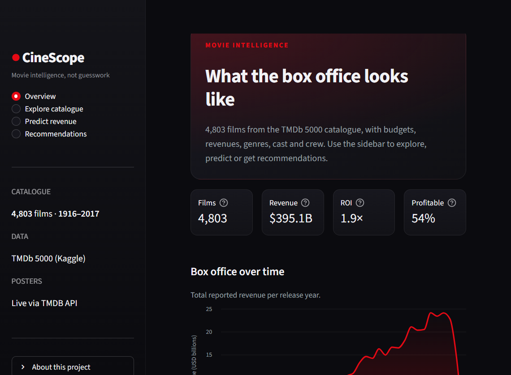

# 🎬 CineScope

**Movie intelligence, not guesswork.** A Streamlit dashboard for exploring 4,800+ films,
estimating box-office revenue from pre-release metadata, and finding similar movies
with content-based recommendations.




## What it does

| Page | What you get |
| --- | --- |
| **Overview** | Portfolio KPIs, revenue by release year, top performers, genre mix |
| **Explore catalogue** | Search and filter 4,803 films, compare budgets against box office, export the slice as CSV |
| **Predict revenue** | Random-forest estimate with an 80% interval, model card, and feature-importance chart |
| **Recommendations** | TF-IDF similarity over plot, genres, keywords, cast and crew, optionally blended with audience ratings |

Pages are deep-linkable via the `page` query parameter, e.g. `/?page=Predict%20revenue`.

## Quick start

Requires **Python 3.11+**.

```bash
git clone https://github.com/fouzzwont/cinescope.git
cd cinescope
python -m venv .venv

# Windows
.venv\Scripts\activate
# macOS / Linux
# source .venv/bin/activate

pip install -r requirements.txt
streamlit run app.py
```

The cleaned dataset (`data/movies.csv`) is committed, so the app works offline out
of the box. On first launch the revenue model trains automatically (about a minute)
and is cached in `models/`, which is gitignored.

## How it works

### Data

The catalogue is the [TMDb 5000 Movie Dataset](https://www.kaggle.com/datasets/tmdb/tmdb-movie-metadata)
(4,803 films, 1916–2017) with movies merged against credits. `scripts/build_dataset.py`
handles the download, JSON parsing, cleaning, and derived fields (`profit`, `roi`,
`weighted_rating`, `release_year`); the committed CSV is the reproducible output.

### Revenue model

Only films with reported budgets **and** revenues are used for training: 3,229 rows,
split 80/20 into 2,583 training and 646 holdout films.

| Metric | Held-out result |
| --- | --- |
| R² | **0.67** |
| Mean absolute error | **$52.5M** |
| Median absolute percentage error | **49%** |
| Predictions within ±25% | **26%** |
| 5-fold CV log-RMSE | **1.290** |

- Target is `log1p(revenue)`, transformed back for reporting.
- Features: log budget, log popularity, runtime, rating, release year, genre,
  language, decade, counts of genres/companies, and budget per minute.
- **Vote count is excluded** because it is a post-release signal that would leak
  the outcome.
- Ridge, Random Forest, and Histogram Gradient Boosting are compared with 5-fold
  cross-validation; the best model is refit on the training split. The current
  winner is a **random forest**.
- The 80% interval comes from the spread of held-out residuals in log space.

### Recommendations

Each film becomes a TF-IDF document built from its overview, tagline, genres,
keywords, cast, director, and production companies. Only one similarity row is
computed per request, so the full 4,803 × 4,803 matrix is never materialised.
An optional rating blend lets well-reviewed films rise above pure textual matches,
and title lookup is exact-first, then fuzzy.

## Project structure

```
app.py                        Streamlit entry point and navigation
movie_intelligence/
  config.py                   Paths, .env loading, TMDB key lookup
  dataset.py                  Raw-data parsing, cleaning, derived features
  modelling.py                Feature engineering, training, evaluation, inference
  recommender.py              TF-IDF recommender with fuzzy title search
  tmdb.py                     Optional TMDB client (posters, live metadata)
  ui/                         Streamlit pages and shared components
scripts/
  build_dataset.py            Rebuild data/movies.csv from Kaggle-style raw files
  train_model.py              Rebuild models/revenue_model.joblib
tests/                        pytest suite (core logic + page smoke tests)
notebooks/                    Original exploratory notebook, kept for reference
legacy/                       Original single-file prototype, kept for reference
docs/screenshots/             README images
```

## Configuration

The app works without any API key. To enable live posters, create `.env` from the
template and add a [TMDB API key](https://www.themoviedb.org/settings/api):

```bash
cp .env.example .env
```

```dotenv
TMDB_API_KEY=your_key_here
```

Without a key, posters fall back to a typographic design. The client only fetches
artwork for films currently on screen, caches responses in memory, and disables
itself after repeated failures. **Never commit `.env`** — it is gitignored.

## Testing and quality

```bash
pip install -r requirements-dev.txt
ruff check .
pytest
```

The suite covers dataset cleaning, model training and inference, fuzzy title
resolution, the TMDB client, and smoke-tests every Streamlit page with
`streamlit.testing`. GitHub Actions runs the same checks on every push and pull
request.

## Deploy on Streamlit Community Cloud

1. Push this repo to GitHub.
2. Create an app at [share.streamlit.io](https://share.streamlit.io) pointing at
   `app.py`.
3. Optionally add `TMDB_API_KEY` under **App settings → Secrets**.

## Limitations

Revenue is notoriously hard to predict from metadata alone. Marketing spend,
release timing, competition, and word of mouth are not in the dataset, so the
model explains roughly two-thirds of the variance and its intervals are wide.
Treat predictions as a sanity check, not a studio forecast. Recommendation
similarity is not a quality score — use the rating filter to surface acclaimed
films.

## Data attribution

Film metadata comes from [TMDb](https://www.themoviedb.org/) via the
[TMDb 5000 dataset](https://www.kaggle.com/datasets/tmdb/tmdb-movie-metadata)
published on Kaggle. This project is not endorsed by TMDb; review the dataset's
terms before redistributing it.

## License

Code released under the [MIT License](LICENSE).
